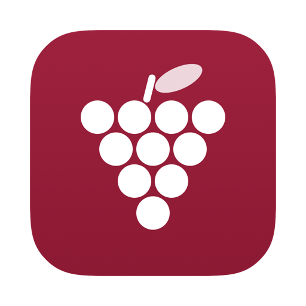
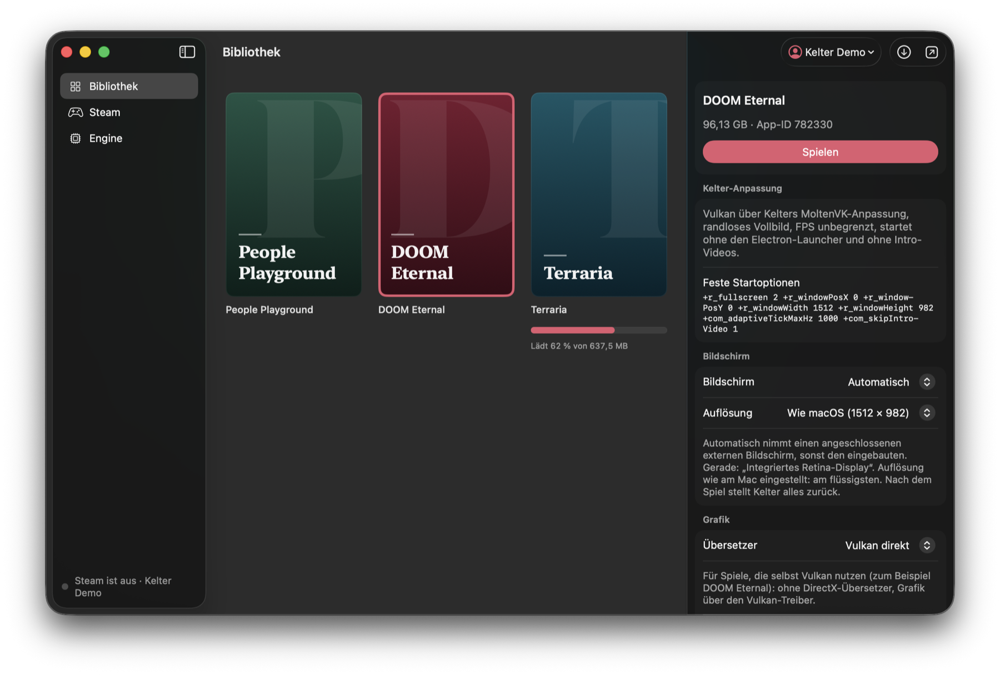
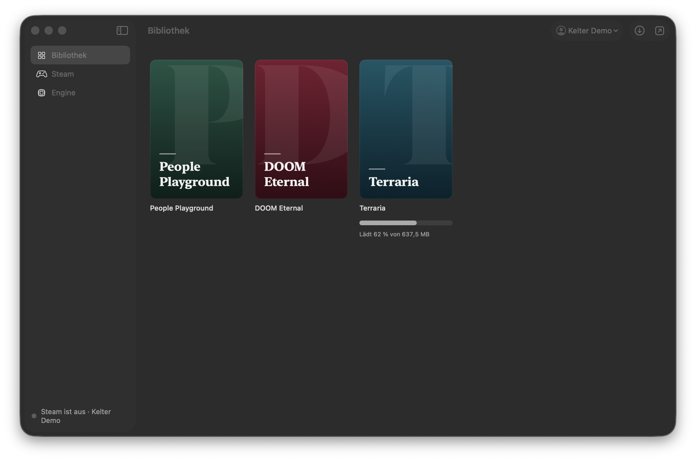
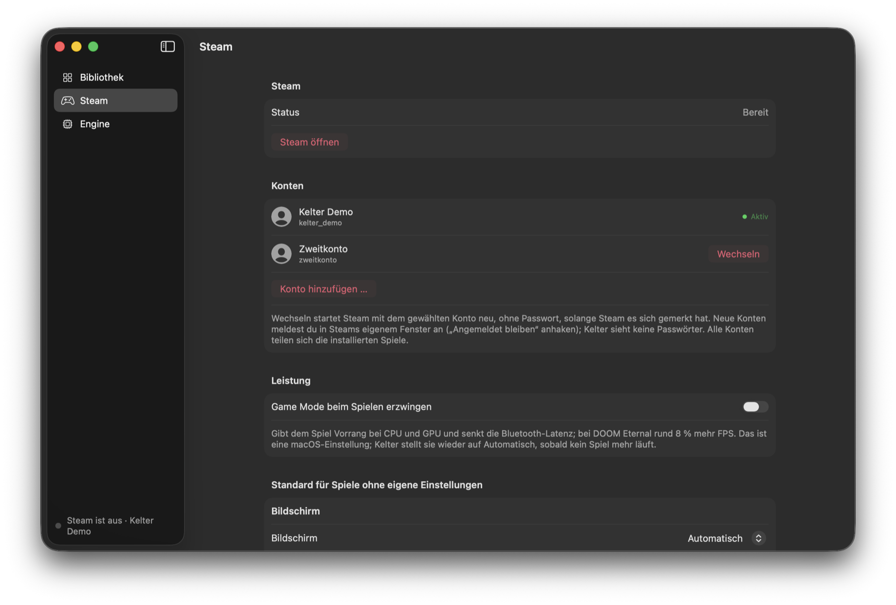
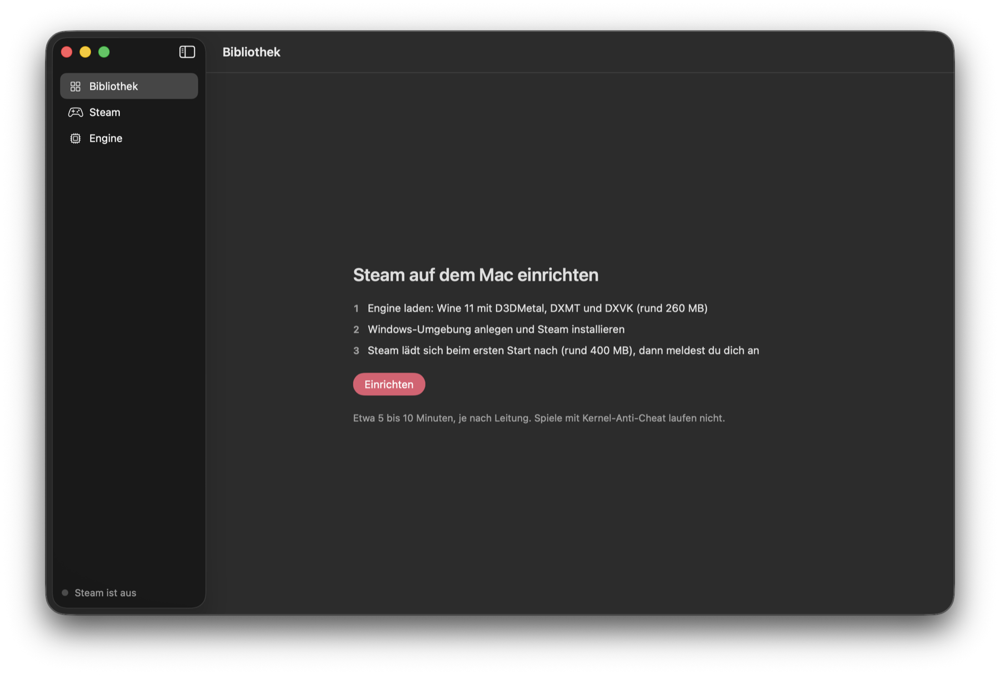
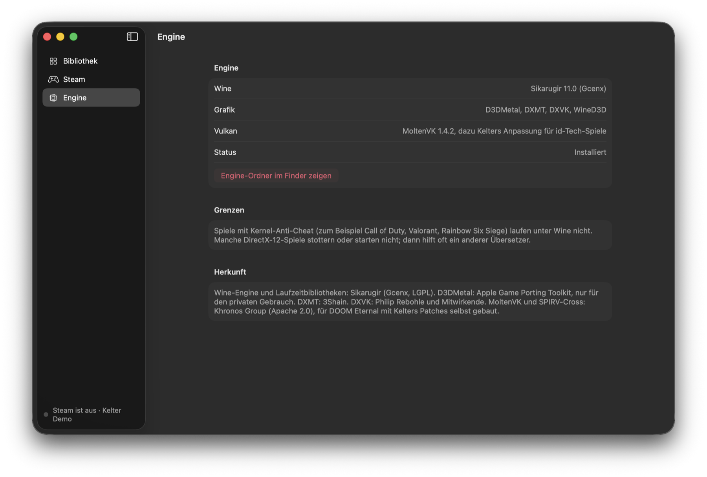

<div align="center">



# Kelter

**Windows-Steam auf dem Mac. Kostenlos.**<br>
Wine 11 mit Apples D3DMetal, DXMT und DXVK, verpackt in eine Mac-App.

[](#installieren)
[](#installieren)
[](Sources/Kelter)
[](LICENSE)



<sub>Alle Bilder zeigen die echte App mit Beispieldaten. Für Spiele ohne Steam-Cover zeichnet Kelter eigene Titelkarten.</sub>

</div>

Proton gibt es nur für Linux. Kelter überträgt die Idee auf den Mac: Wine plus Übersetzer von DirectX
nach Metal, dazu Steam für Windows. Du installierst und startest deine Steam-Spiele wie gewohnt, Kelter
kümmert sich um Grafik, Bildschirm und Konten. Gebaut für Apple Silicon und macOS 15 oder neuer,
geprüft auf macOS 26.5 mit M5 Pro.

> **In English:** Kelter runs Windows Steam on Apple Silicon Macs for free. It sets up Wine 11
> (Sikarugir) with Apple's D3DMetal, DXMT and DXVK, installs Steam and starts your games with
> per-game graphics, display and resolution settings. App and docs are in German. MIT licensed.

> Privates Bastelprojekt, ohne Verbindung zu Valve, Apple oder CodeWeavers. Benutzung auf eigene
> Gefahr. Spiele mit Kernel-Anti-Cheat laufen nicht.

## Was Kelter kann

<table>
<tr>
<td width="50%" valign="top"><br><b>Deine Steam-Bibliothek.</b> Installierte Spiele mit Cover, Download-Fortschritt und „Läuft“-Anzeige. Doppelklick startet, Rechtsklick deinstalliert.</td>
<td width="50%" valign="top"><br><b>Mehrere Steam-Konten.</b> Wechseln ohne Passwort, solange Steam sich das Konto gemerkt hat. Kelter sieht nie ein Passwort.</td>
</tr>
<tr>
<td valign="top"><br><b>Ein Knopf zum Einrichten.</b> Engine laden, Windows-Umgebung anlegen, Steam installieren. Etwa 5 bis 10 Minuten.</td>
<td valign="top"><br><b>Klar, woher alles kommt.</b> Wine-Version, Übersetzer, Grenzen und Lizenzen stehen in der App.</td>
</tr>
</table>

- **Grafik pro Spiel:** „Automatisch“ wählt den passenden Übersetzer. Dazu DLSS durch MetalFX, Raytracing und eigene Startoptionen.
- **Externer Bildschirm:** Ein Spiel öffnet auf Wunsch direkt auf dem angeschlossenen Monitor, auch in dessen voller Auflösung. Nach dem Spiel stellt Kelter alles zurück. Geprüft bisher nur am eingebauten Bildschirm; Rückmeldungen mit externem Monitor sind willkommen.
- **Schneller Start:** Steam startet nur neu, wenn ein Spiel andere Grafik-Einstellungen braucht. Bei laufendem Steam ist People Playground nach 4 Sekunden da.
- **Weniger Bildfehler:** Standards, die Artefakte vermeiden (Fast Math aus, DXMT-Korrekturen, ESync-Kennung unter MSync), pro Spiel abschaltbar.
- **Deinstallieren:** Spielordner, Shader-Cache und Steams Eintrag kommen in den Papierkorb. Spielstände in der Steam-Cloud bleiben.
- **Kommandozeile:** Alles auch per `Kelter --cli`, zum Beispiel `games`, `play <App-ID>`, `accounts`, `displays`.

## Installieren

Voraussetzung: Apple Silicon, macOS 15 oder neuer und Swift 6.2, also Xcode 26 oder dessen Command Line Tools (`xcode-select --install`).

```bash
git clone https://github.com/Maiki09k/kelter.git
```

```bash
cd kelter && scripts/install.sh
```

Für id-Tech-Spiele wie DOOM Eternal braucht Kelter zusätzlich sein gepatchtes MoltenVK. Das baut
`scripts/build-moltenvk.sh` einmalig (braucht Xcode und `cmake`; der erste Lauf lädt rund 500 MB
Abhängigkeiten und dauert 20 bis 40 Minuten), danach
`scripts/install.sh` erneut ausführen. Alle anderen Spiele laufen ohne.

Die App landet in `~/Applications/Kelter.app` (Version 1.1), auf dem Schreibtisch liegt ein Link
darauf (`~/Desktop/Kelter.app`, wird bei jedem Update mitgezogen). Beim ersten Start „Einrichten“ drücken:

1. Engine laden (rund 260 MB): Sikarugir-Wine 11 von Gcenx und die Sikarugir-Hülle mit D3DMetal, DXMT, DXVK, MoltenVK
2. Windows-Umgebung anlegen und Steam installieren
3. Steam lädt sich nach (rund 400 MB), dann erscheint die Anmeldung

Danach Spiele in Steam installieren. Sie erscheinen in der Bibliothek von Kelter; Doppelklick startet.
Ein laufendes Spiel ist in der Bibliothek mit „Läuft“ markiert und steht unten in der Seitenleiste.
„Beenden“ im Einstellungsbereich (oder Rechtsklick auf das Cover) schließt es sofort, auch wenn es
hängt. Ein zweiter Start desselben Spiels wird abgelehnt.

## Grafik pro Spiel

| Übersetzer | Für | Hinweis |
|---|---|---|
| Automatisch | alles | Standard. D3DMetal für 64-Bit DX11/12, DXMT für 32-Bit DX10/11, DXVK 1.10 (nur `d3d9`) für DX9 |
| D3DMetal | DirectX 11 und 12 | nur 64 Bit; 32-Bit und DX9 fallen auf WineD3D. Optional DLSS durch MetalFX, Raytracing |
| DXMT | DirectX 10 und 11 | Oft schneller bei älteren DX11-Spielen; optional MetalFX-Hochskalierung |
| DXVK | DirectX 9 bis 11 | Über Vulkan. Ausweichweg (DXVK 1.10 mit MoltenVK) |
| WineD3D | sehr alte Spiele | DirectX 7 und älter |

Messwerte und Hintergründe stehen in [docs/TECHNIK.md](docs/TECHNIK.md).

## Geprüfte Spiele

| Spiel | Ergebnis (14.11.2026, M5 Pro) |
|---|---|
| People Playground (Unity, DX11) | läuft (Automatisch → D3DMetal), Hauptmenü 118 FPS bei 2,0 ms GPU-Zeit |
| DOOM Eternal (Vulkan) | läuft mit Kelters MoltenVK als randloses Vollbild 1512×982: am Spawnpunkt Kultisten-Basis 129 FPS (vorher 65 im Fenster), GPU 6 ms, also von der CPU (Rosetta) begrenzt. Game Mode bringt zusätzlich rund 8 % |

Du hast ein anderes Spiel getestet? Ein Issue mit Spiel, Übersetzer und Ergebnis hilft allen.

## Was nicht geht

- Spiele mit Kernel-Anti-Cheat (Call of Duty, Valorant, Rainbow Six Siege und ähnliche)
- Manche DirectX-12-Spiele stottern oder starten nicht; dann anderen Übersetzer probieren
- Exklusives Vollbild bei Vulkan-Spielen: Wine schaltet dafür die Mac-Auflösung um (bei DOOM auf
  3024×1964 ohne Retina) und das Spiel hängt danach. Kelter startet DOOM darum als randloses Fenster
  in Bildschirmgröße; im Spiel den Fenster-Modus nicht auf „Vollbild“ stellen. Hängt es doch, setzt
  das Beenden die Auflösung zurück.

## Fragen und Probleme

**Wo finde ich Protokolle?** In `~/Library/Application Support/Kelter/Logs/`: `kelter.log` hält jeden
Steam-Neustart, Spielstart und Bildschirmwechsel mit Grund fest, `game-<App-ID>.log` die Ausgabe von Spielen, die Kelter direkt startet (etwa DOOM Eternal).

**Ein Spiel startet nicht oder zeigt Bildfehler.** In den Einstellungen des Spiels einen anderen Übersetzer
wählen, zum Beispiel DXMT statt D3DMetal. „Auf Standard zurücksetzen“ holt die Standards zurück.

**Steam zeigt nur ein schwarzes Fenster.** Kelter ersetzt Steams Web-Helfer vor jedem Start. Nach einem
Steam-Update startet Kelter Steam einmal neu. `Kelter --cli status` zeigt, ob der Web-Helfer in Ordnung ist.

**Wie entferne ich Kelter ganz?** `~/Applications/Kelter.app`, den Link auf dem Schreibtisch und den Ordner
`~/Library/Application Support/Kelter` löschen. Dort liegen Engine, Steam und alle installierten Spiele.

## Wie es funktioniert

- **Engine:** Wine 11 von Gcenx (Sikarugir) plus die Sikarugir-Hülle mit D3DMetal, DXMT, DXVK und MoltenVK. Kelter lädt beides beim Einrichten von GitHub und prüft die Prüfsummen.
- **Eine Windows-Umgebung („Bottle“)** für Steam und alle Spiele, unter `~/Library/Application Support/Kelter`.
- **Grafik ohne Kopieren:** Die Übersetzer werden per Umgebungsvariable pro Spiel eingehängt, nichts wird in Windows-Ordner kopiert.
- **Web-Helfer-Shim:** Steams eingebautes Chromium zeichnet unter Wine auf dem Mac nur Schwarz. Ein kleines eigenes Windows-Programm startet es mit den nötigen Schaltern.

Alles Weitere, auch zu DOOM Eternal und den MoltenVK-Patches: [docs/TECHNIK.md](docs/TECHNIK.md).

## Selbst bauen und prüfen

```bash
swift test
```

```bash
.build/debug/Kelter --cli status
```

Weitere Befehle: `setup`, `steam`, `games` (mit „läuft“), `play <App-ID>`, `quit <App-ID>` (Spiel beenden), `uninstall <App-ID> [--dry-run]`, `displays`, `accounts`, `account <SteamID|Name|neu>`, `stop`, `set <App-ID|default> schlüssel=wert`,
`reset <App-ID>`, `env <App-ID>` (Umgebung als export-Zeilen), `guard [Sekunden]` (Shim-Wächter von Hand),
`run <d3dmetal|dxmt|dxvk|wined3d> <Programm.exe>`.

Oberfläche ohne Klicken prüfen: `KELTER_HOME=<Testordner>` nimmt andere Daten,
`KELTER_PAGE=steam|engine` öffnet eine Seite, `KELTER_SELECT=<App-ID>` die Einstellungen eines Spiels.

Shim, Testprogramme und MoltenVK neu bauen: [docs/TECHNIK.md](docs/TECHNIK.md#bauen-shim-und-testprogramme).

## Lizenzen

Kelters eigener Code: [MIT](LICENSE). Das gilt auch für den Web-Helfer-Shim
(`Resources/steamwebhelper-shim.exe`, gebaut aus `shim/webhelper-shim.c`).

Kelter liefert keine fremden Laufzeitteile mit. Beim Einrichten lädt es sie von den Original-Releases
(Prüfsummen in `Catalog.swift`):

| Teil | Herkunft | Lizenz |
|---|---|---|
| Wine 11, Sikarugir-Hülle | Gcenx, Sikarugir-App auf GitHub | LGPL |
| DXMT | 3Shain | siehe Projekt 3Shain/dxmt |
| DXVK | Philip Rebohle und Mitwirkende | zlib |
| MoltenVK, SPIRV-Cross | Khronos Group; Kelters Patches dazu in `shim/` | Apache 2.0 |
| D3DMetal | Apple Game Porting Toolkit, enthalten in der Sikarugir-Hülle | Apples Lizenz, keine Weitergabe |
| Steam | Valve, `SteamSetup.exe` vom Steam-CDN | Steam-Abonnementvertrag, bei der Anmeldung zu bestätigen |

Steam, DOOM und andere Spielenamen sind Marken ihrer Inhaber.
